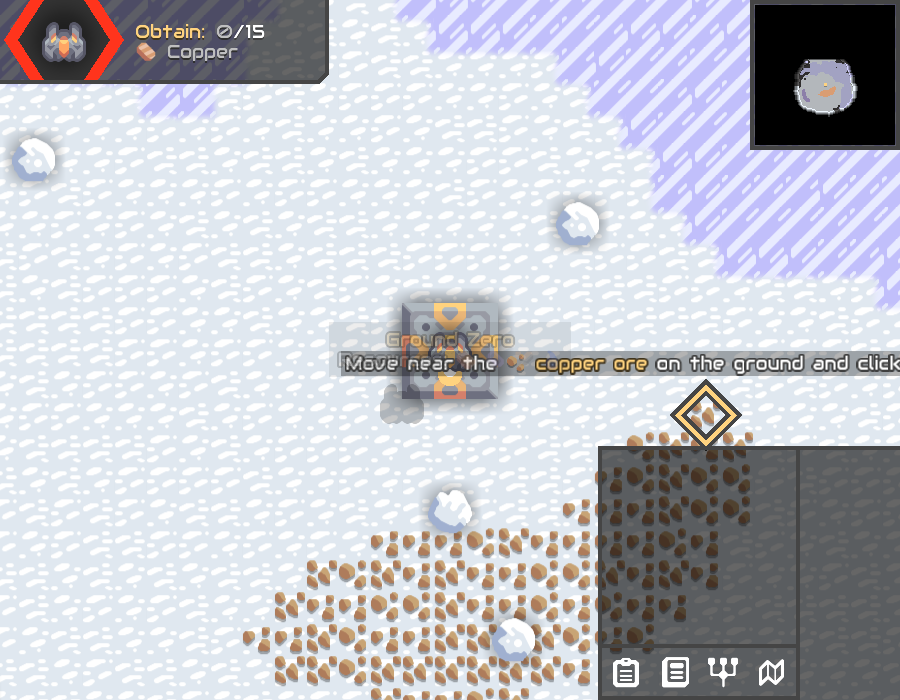
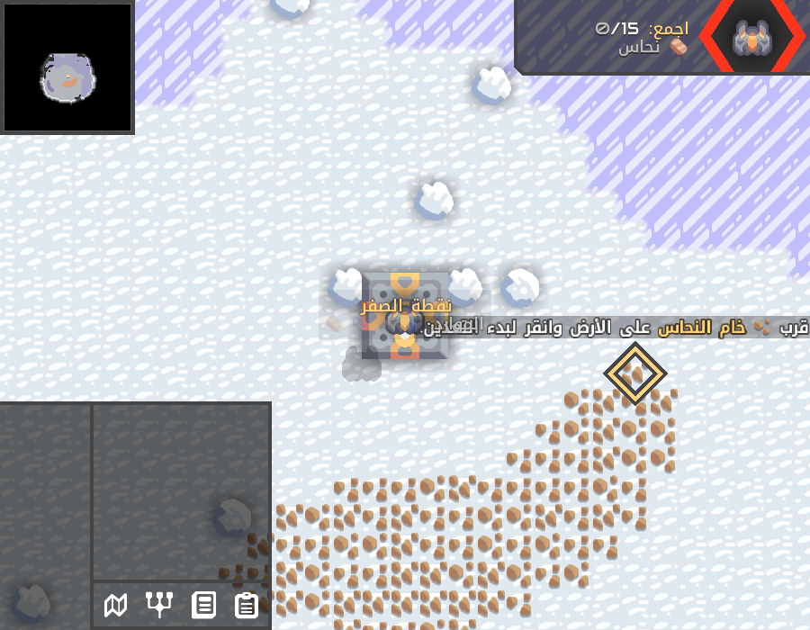
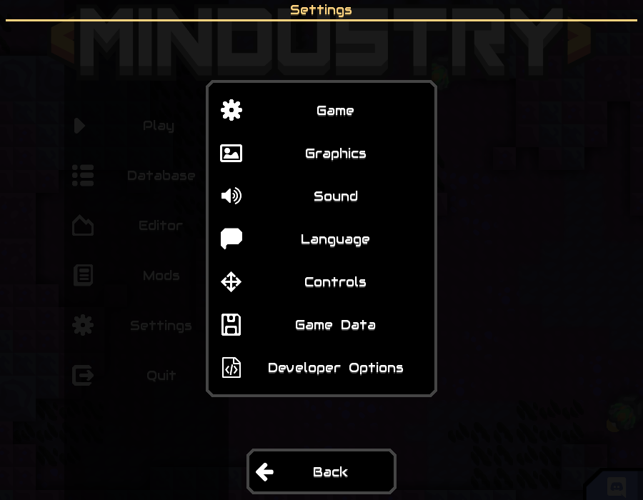
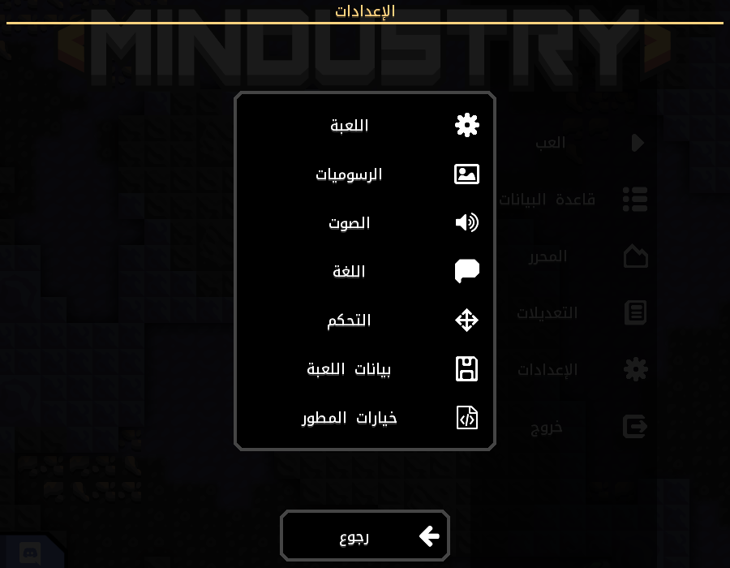
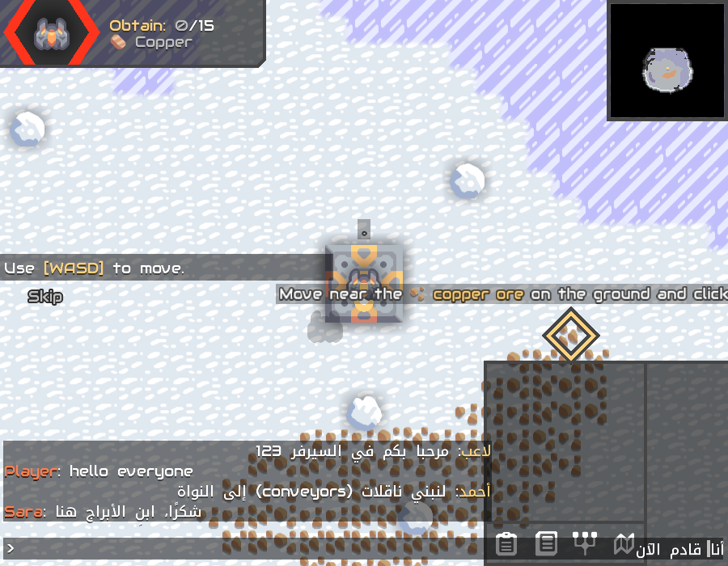
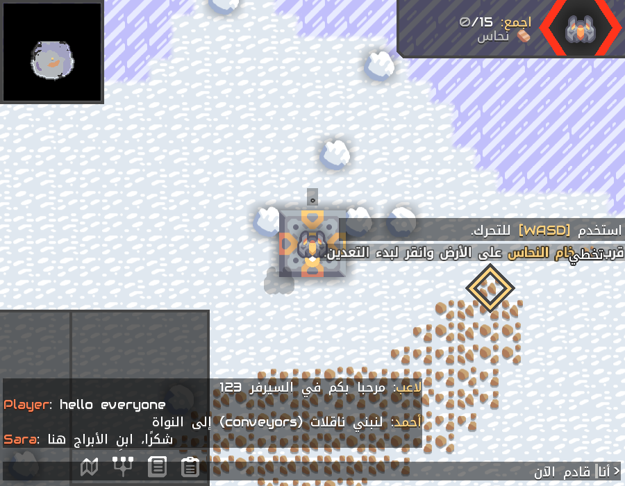

# Arabic / RTL support – proof of concept

> **This is an AI-generated prototype** (code by Claude; the Arabic translation was machine-translated and machine-reviewed).
> It only exists to show that Arabic support is feasible. It will **not** be submitted as a pull request:
> the real implementation will be written by hand, following the AI policy in `CONTRIBUTING.md`.

| English | Arabic |
|---|---|
|  |  |
|  |  |
|  |  |

More screens in `screenshots/en` and `screenshots/ar`.

## What works
- Arabic letter shaping, right-to-left text, mixed Arabic / English / numbers, line wrapping and color tags.
- Mirrored UI when the language is Arabic.
- Harakat (diacritics), drawn over or under their letter.
- Text fields (including chat): correct cursor position, selection, scrolling and arrow keys in Arabic text.
- Text layout does not allocate memory and does not use `java.text` (bidi is a small built-in implementation).

## Planned pull requests (to Arc, written by hand)
1. FreeType: support fonts without Latin glyphs.
2. Arabic letter shaping.
3. Bidi (right-to-left ordering).
4. UI mirroring.

Then the Mindustry side (font and settings) and a human-made Arabic translation.
None of this changes anything for other languages.

## Known gaps
- Tested on desktop (Linux) and Android. Not tested on iOS.
- Multi-line text areas still use the left-to-right cursor logic.
- Sliders and arrow icons are not mirrored.
- Harakat are positioned with a simple rule (centered on the letter), not with the font's positioning data.

The engine changes are on the `arabic-rtl-spike` branch of [3mro777o/Arc](https://github.com/3mro777o/Arc/tree/arabic-rtl-spike).
